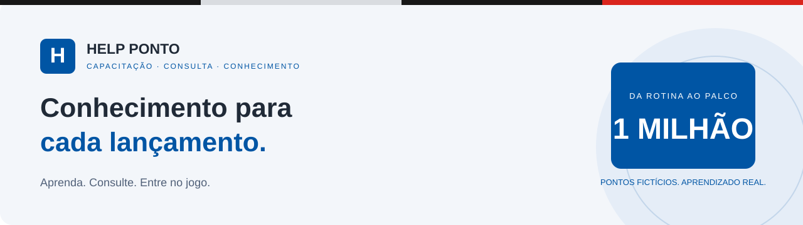
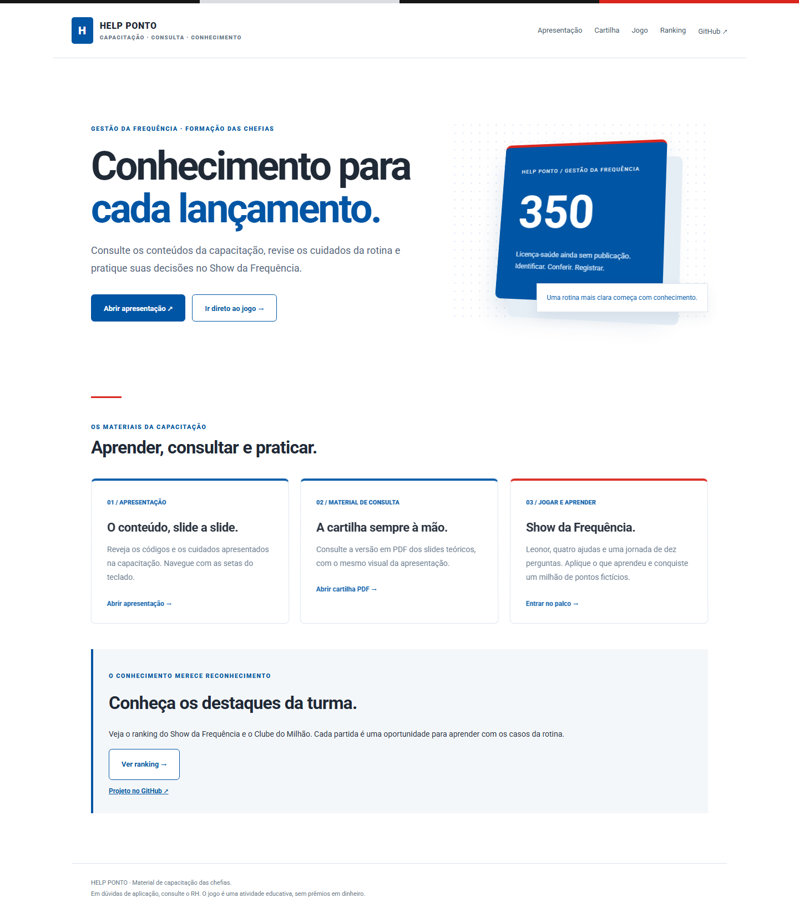
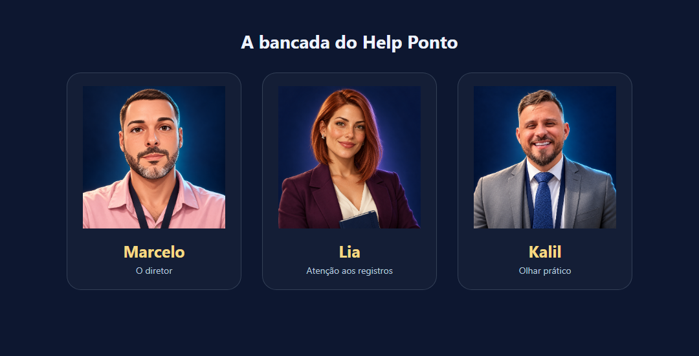
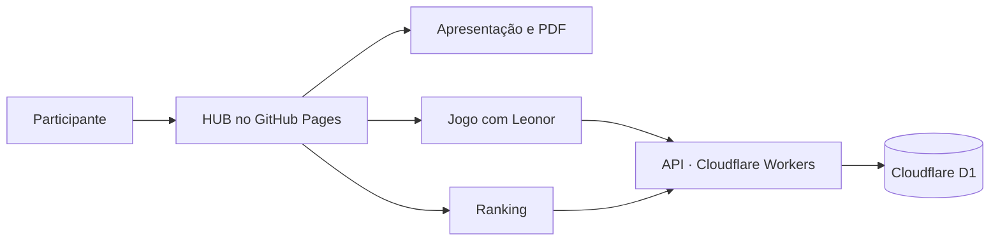

<div align="center">



# Curso Help Ponto

**Uma experiência de capacitação para transformar conhecimento em decisões na rotina.**

Apresentação, material de consulta e um jogo com Leonor, casos de frequência e ranking online.

[](https://kalicon.github.io/Curso-Helpponto/)
[](https://kalicon.github.io/Curso-Helpponto/jogo.html)
[](https://kalicon.github.io/Curso-Helpponto/ranking.html)
[](https://kalicon.github.io/Curso-Helpponto/materiais/Cartilha_Help_Ponto.pdf)

**71 questões revisadas** · **10 perguntas por partida** · **4 ajudas** · **1 milhão de pontos**

[Conheça o curso](#conheça-o-curso) · [Explore o jogo](#entre-no-palco) · [Dúvidas frequentes](#dúvidas-frequentes) · [Área técnica](#área-técnica)

</div>

---

## Conheça o curso

Criado para apoiar as chefias na gestão da frequência, o projeto reúne conteúdo para aprender, consultar e praticar. As perguntas apresentam situações da rotina e ajudam a exercitar a escolha dos lançamentos e as boas práticas de conferência.

| Aprenda | Consulte | Pratique |
| --- | --- | --- |
| Apresentação com os conteúdos da capacitação e uma tela de aula prática antes do encerramento. | Cartilha em PDF com os slides para baixar e ter por perto. | Show da Frequência: perguntas, decisões, ajudas e feedback a cada rodada. |
| [Abrir apresentação](https://kalicon.github.io/Curso-Helpponto/assets/Slide01.html) | [Baixar cartilha](https://kalicon.github.io/Curso-Helpponto/materiais/Cartilha_Help_Ponto.pdf) | [Começar uma partida](https://kalicon.github.io/Curso-Helpponto/jogo.html) |

<details>
<summary><strong>📷 Veja o HUB da capacitação</strong></summary>

[](https://kalicon.github.io/Curso-Helpponto/)

</details>

## Entre no palco

No **Show da Frequência**, Leonor conduz uma jornada de dez perguntas até o milhão. O sorteio das questões e o embaralhamento das alternativas tornam cada partida diferente.

1. **Identifique-se:** informe seu nome ou um apelido reconhecível pelo grupo.
2. **Encare os casos:** leia a situação e escolha sua resposta.
3. **Use suas ajudas:** peça apoio quando precisar, antes de confirmar.
4. **Aprenda com o resultado:** confira a explicação e avance na jornada.
5. **Conquiste seu lugar:** ao concluir, o desempenho é enviado ao ranking online.

| Ajuda | Como funciona |
| --- | --- |
| Eliminar alternativas | Reduz as opções disponíveis para a decisão. |
| Consultar Leonor | Mostra uma dica sobre a situação apresentada. |
| Pular a pergunta | Permite seguir para outra questão. |
| Consultar a bancada | Marcelo, Lia e Kalil dão seus palpites; eles também podem errar. |

<details>
<summary><strong>🎭 Conheça Marcelo, Lia e Kalil</strong></summary>



Personagens ilustrados que acompanham a experiência do jogo.

</details>

<details>
<summary><strong>👑 Espie a conquista do milhão</strong></summary>


A pergunta final ganha uma entrada especial. O décimo acerto traz a comemoração com Leonor e o reconhecimento no Clube do Milhão. A imagem usa um participante de teste.

</details>

**Pontos fictícios, aprendizado de verdade.** Esta é uma atividade educativa, sem premiação em dinheiro.

## Dúvidas frequentes

<details>
<summary><strong>Preciso instalar algum programa?</strong></summary>

Não. [Abra o HUB](https://kalicon.github.io/Curso-Helpponto/) no navegador e escolha o material. O site e o ranking compartilhado precisam de internet; a cartilha pode ser baixada para consulta posterior.

</details>

<details>
<summary><strong>Posso continuar uma partida interrompida?</strong></summary>

Sim. Neste mesmo navegador, uma partida pode ser recuperada por até 24 horas, preservando a pergunta e as ajudas utilizadas. Em computadores compartilhados, confira o nome antes de retomar. Limpar os dados do navegador remove a partida guardada.

</details>

<details>
<summary><strong>O resultado é salvo automaticamente?</strong></summary>

Ao concluir a partida, o jogo envia o desempenho para o ranking. Se houver falha na conexão, o envio fica pendente neste navegador, que tenta novamente ao reconectar, reabrir o jogo ou usar o botão de reenvio. Cada partida tem um identificador para evitar duplicação. Limpar os dados do navegador remove os envios pendentes.

</details>

<details>
<summary><strong>Meu nome aparece no ranking?</strong></summary>

Sim, o ranking é público. Você pode usar um apelido reconhecível pelo grupo. Nomes iguais são agrupados, então escolha uma identificação que evite confusão. O ranking tem finalidade educativa e não verifica a identidade dos participantes.

</details>

<details>
<summary><strong>Como funcionam a voz e a música?</strong></summary>

Leonor utiliza as vozes disponíveis no navegador e no dispositivo. A disponibilidade e a qualidade da voz feminina podem variar. A trilha de suspense é sintetizada pelo próprio jogo. O áudio começa após interação do participante e pode ser ajustado nas configurações.

</details>

<details>
<summary><strong>Funciona em celular e tablet?</strong></summary>

As páginas possuem adaptações de layout, e foram feitas verificações em Chrome e em tamanhos de tela de celular. A compatibilidade com todos os navegadores e dispositivos ainda não foi certificada. As animações respeitam a preferência por movimento reduzido.

</details>

## Área técnica

O HUB, a apresentação e o ranking seguem a identidade institucional: azul `#0055A4`, branco, cinza, vermelho e Roboto. O jogo possui sua própria identidade de palco. As páginas de comunicação usam GSAP para animações de scroll e profundidade.



<details>
<summary><strong>📁 Estrutura dos entregáveis</strong></summary>

| Caminho | Finalidade |
| --- | --- |
| `site/` | Arquivos públicos do HUB, apresentação, cartilha, jogo e ranking |
| `servico-ranking/` | Código, configuração e testes da API de resultados |
| `.github/workflows/pages.yml` | Workflow manual de publicação no GitHub Pages |
| `docs/images/` | Capa e prévias usadas neste README |
| `Site_GitHub_Pages.zip` | Pacote dos arquivos públicos para entrega |

Somente `site/` é enviada ao GitHub Pages. A API tem implantação própria: [documentação do serviço de ranking](servico-ranking/README.md).

Ferramentas de validação de perguntas, pareceres, documentos internos e o guia prático ainda em validação ficam fora da entrega pública. Capturas com dados pessoais não devem ser incluídas no repositório.

</details>

<details>
<summary><strong>🚀 Como atualizar e publicar</strong></summary>

Este repositório contém os entregáveis gerados. No ambiente de desenvolvimento, faça as alterações nos arquivos de origem e execute `publicacao/gerar-entregaveis.py`. Ajustes feitos diretamente em `site/` podem ser sobrescritos pela próxima geração.

1. Gere e confira os entregáveis, os links e as perguntas.
2. Envie as alterações para a branch `main`.
3. Abra [Actions → Publicar site](https://github.com/Kalicon/Curso-Helpponto/actions/workflows/pages.yml) e selecione **Run workflow**.
4. Aguarde a conclusão e confira o HUB, o jogo e o ranking online.

A publicação é manual: um commit não atualiza automaticamente o site. Alterações apenas no README e em suas imagens não exigem nova publicação no Pages.

</details>

<details>
<summary><strong>🧪 Testes do serviço de ranking</strong></summary>

Use uma versão recente do Node.js com suporte a `node:sqlite` e, na pasta `servico-ranking/`, execute:

```sh
npm ci
npm test
```

Consulte a [documentação técnica](servico-ranking/README.md) antes de alterar a API ou o banco.

Nunca inclua tokens, `RATE_SALT`, arquivos `.env`, `.dev.vars`, bancos locais ou credenciais em commits. Os arquivos públicos usam somente o endereço da API.

</details>

---

<div align="center">

**O conhecimento ganha valor quando chega à prática.**

[Ir para o curso](https://kalicon.github.io/Curso-Helpponto/) · [Jogar com Leonor](https://kalicon.github.io/Curso-Helpponto/jogo.html) · [Consultar o ranking](https://kalicon.github.io/Curso-Helpponto/ranking.html)

</div>
